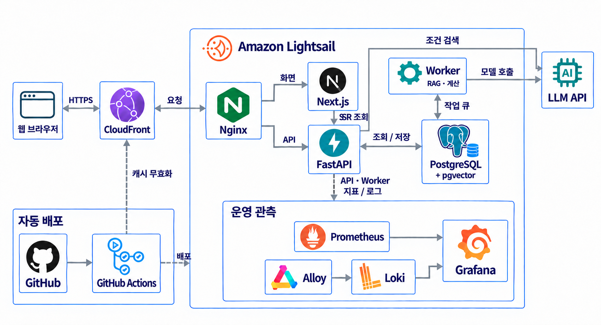

# PokeSettle

Pokémon Champions 랭크 싱글의 팀 선출과 대면 판단을 돕는 RAG 기반 포켓몬 전략 서비스

[서비스 바로가기](https://pokesettle.com/ko)

## 주요 기능

| 기능 | 내용 |
| --- | --- |
| 전략 챗봇 | 상황별 전략 질문, 답변 근거 확인, 대화 기록 저장 |
| 포켓몬 도감 | 이름·타입·자연어 조건 검색, 종족값·특성·기술 조회 |
| 메타 순위 | 사용률 순위와 주요 세팅, 출처·기준일 확인 |
| 6:6 시나리오 | 양쪽 팀 구성, 3마리 선출·선봉·공격·교체 비교, 참조 데미지 계산 |

## 시스템 아키텍처

전투 계산과 모델 설명 분리, 인용 ID·원문 버전 검사 후 답변 저장

## 기술 구성

| 영역 | 기술 |
| --- | --- |
| 프론트엔드 | Next.js, React, TypeScript, Tailwind CSS |
| 백엔드·RAG | Python, FastAPI, LangChain, LangGraph, ONNX 임베딩 |
| 데이터·계산 | PostgreSQL, pgvector, JSON, @smogon/calc |
| 배포·운영 | AWS CloudFront·Lightsail, Nginx, Docker Compose, GitHub Actions, Prometheus, Alloy, Loki, Grafana |

## 사용 범위

- 일반 도감 정보와 현재 Champions 참가·기술 허용 여부 구분
- 타입 기반 선출 점수·참조 데미지와 실제 승률·게임 결과 구분
- 근거의 확인 범위에 따라 사실·가정·미확인 정보 구분
- Pokémon 공식 서비스와 무관한 비공식 팬 프로젝트

## 관련 문서

- [제품·구조·API](docs/design/PROJECT_SPEC.md) · [설정·실행·배포](docs/guides/OPERATIONS.md) · [출처·이용 조건](docs/guides/DATA_SOURCES.md)
- [PokéAPI 라이선스](data/licenses/POKEAPI_LICENSE.md) · [참조 계산기 라이선스](backend/calculator/LICENSE.smogon-calc)
- 포켓몬 이미지: [PokéAPI sprites](https://github.com/PokeAPI/sprites), Pokémon © The Pokémon Company
