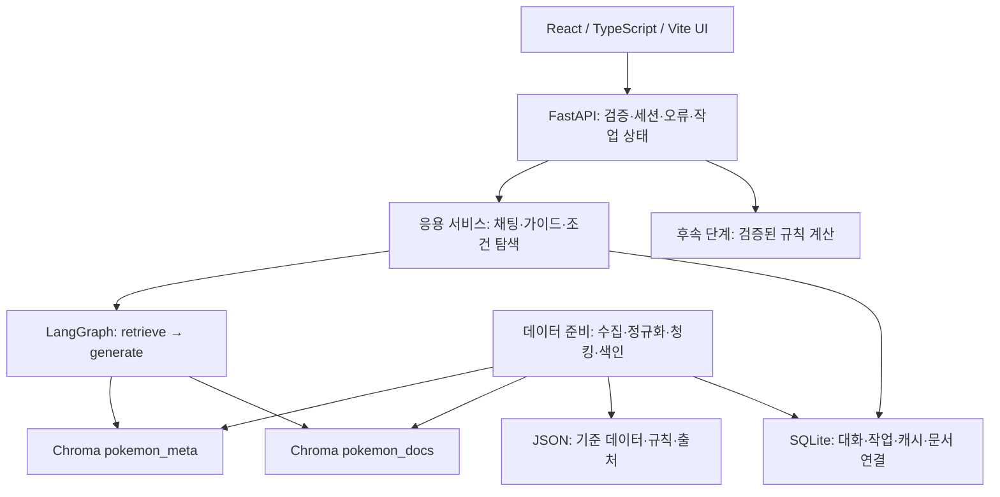

# 아키텍처 및 데이터 구조 설계

작성일: 2026-10-21. Phase 0 제안 계약임. 아래 경로·모델·설정은 향후 구현 설계이며 실제 모듈이나 데이터베이스를 생성하지 않음.

> Phase 1 업데이트: 아래는 설계 당시의 기준임. 현재는 데이터 수집·두 컬렉션·LangGraph·API를 구현함. 실제 저장은 `backend/storage.py`의 SQLite 세션/대화/메시지/작업 테이블과 namespace별 JSON 캐시를 사용함. 문서·후보·manifest·인용 스냅샷은 이 캐시와 메시지 JSON에 저장해 Phase 1에서 불필요한 별도 테이블을 축소함. 모델 설정과 검증은 [실행 결과](TEST_RESULTS.md)에 기록함.

> Phase 2 업데이트: `frontend/src/components`는 대화·인용·포켓몬 프로필, `hooks/useWorkspace.ts`는 세션·대화·작업 상태, `services/api.ts`는 HTTP 경계를 담당함. React Query 캐시 키를 포켓몬/대화/작업 ID로 나누고 전송 시점의 ID에 결과를 연결함. UI의 계산은 실제 종족값 표시뿐이며 전투 계산 모듈은 아직 없음. 조건 해석과 실제 속성 검증은 `backend/discovery.py`에 분리함. [검증 결과](PHASE2_RESULTS.md) 참조.

관련 문서: [요구사항과 단계 계획](REQUIREMENTS.md), [출처 검증](DATA_SOURCES.md), [API 계약](API_SPEC.md).

## 1. 구조와 책임



| 영역 / 제안 경로 | 책임 | 경계 |
|---|---|---|
| `frontend/src` | 선택·대화·인용·조건 입력·진행 상태 표시 | 외부 모델 키·수집 로직·계산식 보유 금지 |
| `backend/api`, `models` | 요청 검증, camelCase API 변환, 세션 검증, HTTP 응답 | 문서 수집이나 전투 계산 직접 수행 금지 |
| `backend/services` | 수집 작업·채팅·가이드·탐색·저장 조정 | RAG 근거와 계산 결과를 구분 |
| `backend/data_preparation` | 도메인별 원본 수집·ID/명칭 매핑·필드 검증·검색 텍스트 | 일반 검색/생성 모듈에 도메인별 수집 규칙 분산 금지 |
| `backend/rag` | 컬렉션 접근, splitter, retriever, prompts, graph, 인용 검증 | 원본 진실은 JSON/출처 저장소, 벡터 DB는 파생 색인 |
| `backend/storage` | SQLite 저장과 트랜잭션 | UI에서 DB 직접 접근 금지 |
| `backend/battle` | Phase 3 이후 검증된 상성·적격성·후보 계산 | LLM이 데미지·확률을 산출하지 않음 |

초기 운영은 개인용 로컬 단일 FastAPI 프로세스와 SQLite/Chroma 영속 디렉터리임. 별도 큐·Redis·Node 서비스·Zustand를 미리 도입하지 않음. 작업은 백그라운드 실행하고 상태를 SQLite에 남겨 polling으로 표시함. 프로세스 재시작 시 진행 중 작업을 `interrupted`로 복구하고 완료를 가장하지 않음. 다중 프로세스/외부 공개는 추후 인증·작업 큐 설계 후 지원함.

## 2. 수집·색인 경로

1. JSON 데이터 검증 후 항목당 하나의 텍스트를 구성함. 변하지 않는 `pokemon_id`로 `pokemon_meta` upsert.
2. 항목+질문을 Prompt 1에 넣어 검색어를 추출함. 검증된 정식 이름/별칭으로 **항목 자체 문서 검색을 프로그램에서 추가 보장**함. 질문/프롬프트 버전별 추출 결과도 재사용함.
3. 출처·언어·스코프·정규화 검색어 캐시를 먼저 확인함. 성공 캐시가 있으면 외부 검색을 반복하지 않음.
4. 후보 ID·제목·요약을 Prompt 2에 전달함. 모델 선택과 별개로 식별이 확인된 자체 문서는 반드시 채택함. 본문 길이가 짧아도 임의 제외하지 않음.
5. 사용 조건을 확인한 원문 본문·출처·버전을 저장함. 자체 문서 부재/접근 실패/권리 미확인은 `missing_subject_document`로 보고하며 수집 완료로 기록하지 않음. 수집 불가능한 원문을 조작하거나 이용 제한을 우회하지 않음.
6. 설정에 따라 청킹함. `pokemon_docs`에 항목별 연결을 포함해 upsert하고, 이전 인덱스 버전의 불필요한 청크는 제거함.
7. 문서/청크 manifest와 실제 Chroma ID를 대조한 후에만 작업을 완료 처리함. 재시도 시 이미 완료한 문서는 재사용함.

검색어 캐시의 상태는 `pending`/`partial`/`complete`/`failed`임. `complete`는 필요한 본문 수집과 해당 색인의 성공까지 확인한 경우임. 원문 캐시와 색인 상태는 별도여서 색인만 실패하면 다운로드 없이 재색인함. 청킹 설정 변경도 저장된 본문만으로 처리함. 명시적 새 규칙 스냅샷/갱신 외에는 동일 성공 검색어를 다시 수집하지 않음.

## 3. 질의응답 경로

필요한 수집은 그래프 진입 전에 응용 서비스가 처리함. LangGraph의 최소 노드는 다음 **두 개**임.

```text
START → retrieve → generate → END
```

### retrieve

- 선택 항목의 `pokemon_meta`를 ID로 가져옴. 유사도 순위와 무관하게 근거에 넣음. 없으면 `INDEX_NOT_READY`이며 다른 종의 메타로 대체하지 않음.
- `pokemon_docs`에서 항목 연결, 게임/포맷/규칙 적용 범위를 확인해 유사도 검색함. Champions 확정 질문에는 부적합 포맷을 제외함. 일반 설명 자료를 쓸 때는 `generic`임을 드러내며 적격성/기술 사용 가능성을 추론하지 않음.
- `TOP_K`는 **선택 메타 포함 총 근거 수**로 정의함. 기본 제안 6 = 메타 1+외부 최대 5. 문서가 부족하면 채우기 위해 중복을 넣지 않음.
- 같은 항목/원문 버전/청크 위치는 하나로 병합함. 같은 본문 복사본은 URL 정규화와 해시로 중복 억제하되 출처 연결을 보존함. 원래 내용이 다른 청크나 메타/외부의 출처 유형은 무조건 합치지 않음.
- 중복 제거로 부족하면 후보를 추가 조회해 상한 내에서 채움. 최종 근거에 번호를 부여하고, 토큰 제한에서 메타를 우선 보존함. 문서 수·부족 이유를 상태에 기록함.

### generate

- Prompt 3에는 이번 질문의 근거와 명시된 가정만 전달함. 대화 기록은 질문 해석용이며 과거 답변 자체를 사실 근거로 삼지 않음.
- 주요 주장별 근거 ID, 답변, 사실/가정/미확인을 구조화하여 생성함. 질문을 뒷받침하는 내용이 없으면 '문서에서 확인되지 않습니다'로 유보함. 메타가 있다는 이유만으로 전략을 생성하지 않음.
- 서버가 인용 ID 존재와 실제 문서 연결을 검증하고 본문에 `[근거 n]`을 붙임. 실패한 출력은 제한된 재생성 또는 유보로 전환함. ID 유효성 검사는 주장 진실성을 증명하지 않으므로 대표 질문 수동 평가도 필요함.
- 화면용 `citations`에는 실제 인용한 근거만 넣음. 서로 다른 청크가 같은 문서라면 문서 카드로 묶고 번호·쪽 범위를 유지함. 근거가 없거나 실제 인용이 없으면 별도 안내를 전달함.
- Phase 1 구현에서는 `claims.source_versions`를 분리해 인용 본문에 실제 있는 원래 게임 식별자만 서버가 붙임. 메타의 `generic`/`unknown`은 버전으로 취급하지 않음. 인용/버전 검증 실패는 한 번 교정 요청 후 유보함.
- 문서 본문은 신뢰하지 않는 자료로 취급하고 그 안의 명령·키 요구를 실행하지 않음.

그래프 상태 제안: `pokemon_id`, `conversation_id`, `question`, `regulation_id`, `retrieved_evidence`, `evidence_by_id`, `answer`, `facts`, `assumptions`, `unknowns`, `citations`, `warnings`, `timings`. 스키마 검증 전 LLM 출력을 저장된 사실로 승격하지 않음.

## 4. 세 프롬프트 계약

| 프롬프트 | 역할/입력 | 출력 | 실패 처리 |
|---|---|---|---|
| Prompt 1 | 포켓몬 자료 조사자. 선택 ID·검증된 이름·질문·대상 포맷에서 외부 검색어 추출 | `{ "queries": [{"query":"검색어", "language":"ko"}] }` | JSON/길이/타입 검증, 제한 재시도. 자체 문서 검색은 모델에 의존하지 않음 |
| Prompt 2 | 후보의 제목·요약만 보고 질문 관련 문서 선택 | `{ "selected_candidate_ids": [], "decisions": [{"candidate_id":"...", "reason":"..."}] }` | 제공하지 않은 ID 거부. 자체 문서 채택은 후처리로 강제. 채택·기각 사유 기록 |
| Prompt 3 | 검색 근거만 쓰는 전략 설명자. 질문·출처 유형·근거·적용 범위 입력 | `{ "answer_status":"answered|partial|abstained", "claims":[{"text":"...","evidence_ids":[]}], "assumptions":[], "unknowns":[] }` | 주장/ID 검증, 유보. 가정으로 실제 규칙을 덮어쓰지 않음 |

본문 인용 번호는 서버가 evidence ID를 기준으로 확정함. 프롬프트는 템플릿 버전을 저장하고 API나 UI에 전문을 노출하지 않음. LLM은 원문에 없는 URL·이름 매핑·배틀 수치를 만들 수 없음.

## 5. 자연어 탐색과 도메인 특화 기능

자연어 조건은 허용된 필드·연산자로 변환함. 예: '스피드 종족값 100 이상인 드래곤 타입'→타입 포함 AND `base_stats.speed >= 100`. 이름·타입·수치 등 정확 조건은 JSON/정규화 데이터 전체에서 검증하고, 서술형 관련도는 `pokemon_meta` 검색으로 정렬함. 유사도 후보 제한만으로 정확 필터 결과의 완전성을 주장하지 않음.

미확인 속성은 참으로 취급하지 않음. '빠른', '안전한'처럼 기준이 모호하면 임의 수치를 만들지 않고 `needs_clarification`과 해석 안내를 반환함. '땅 무효'는 타입·특성·예외에 대한 검증된 규칙이 없으면 확정 일치 결과에 넣지 않음. 반환 결과는 클릭해 해당 포켓몬 대화로 연결함.

F2010의 MVP는 **근거 기반 운용 가이드**임. 문서가 뒷받침하는 역할·주의점·포맷을 같은 retrieve/generate 경로로 정리하고 인용함. 자료가 없으면 유보함. 별도 타입/데미지 엔진이 없어도 필수 RAG 서비스 기능을 검증할 수 있도록 함.

## 6. 데이터 공통 규칙

- 내부 Python·JSON·SQLite는 snake_case, TypeScript·REST JSON은 camelCase. API 경계에서 명시적으로 변환함.
- 논리 ID는 문자열로 취급함. 종 ID와 폼 ID를 분리하고 외부 API 숫자 ID와 내부 ID를 매핑함. 기본 항목은 `pokemon_id`, 변형은 별도 `form_id`로 참조함.
- `null`=미확인/미수집, `[]`=확인된 빈 목록임. 확인하지 않은 기술 목록을 빈 목록으로 저장하지 않음.
- `verification_status`: `verified`/`assumed`/`unknown`. 검증된 정보도 `scope`와 provenance 필수. 사용자 입력은 `origin=user_input`으로 표시해 공식 검증과 구별함.
- `eligibility_status`: `eligible`/`ineligible`/`unknown`으로 별도 표현함. 검증 등급과 합법성 판정은 서로 다른 축임.
- 날짜는 저장/API에서 UTC ISO 8601, 표시 시 지역 시간으로 변환함. 규칙의 유효기간과 원문 확인일을 구분함.
- 값·확신 상태·근거는 필드별로 연결함. 검증 안 된 부분을 레코드 전체 verified로 승격하지 않음.

### 6.1 JSON 기준 데이터

| 데이터 | 주요 필드와 타입 | 제약 |
|---|---|---|
| `pokemon.json` | `pokemon_id:string`, `external_ids:object`, `name_ko:string|null`, `name_en:string`, `types:string[]|null`, `base_stats:{hp,attack,defense,sp_attack,sp_defense,speed}:int|null`, `abilities:string[]|null`, `available_moves:string[]|null`, `mega_forms:string[]|null`, `description:string|null`, `champions_eligibility_status:enum`, `eligible_regulations:string[]|null`, `field_provenance:object` | ID 고유, 참조 ID 존재. 종족값과 실전 능력치 구별. 일반 기술 목록과 Champions 기술 목록 혼용 금지 |
| `moves.json` | `move_id`, `name_ko/name_en`, `type`, `category`, `power`, `accuracy`, `priority`, `pp`, `effects`, `applicability`, `field_provenance` | 변화기 위력/필중 정확도는 임의 0/100으로 정규화하지 않음. 수치·단위 명시 |
| `abilities.json` | `ability_id`, 이름, `description`, `calculation_interactions`, `applicability`, provenance | 설명만으로 계산 구현 검증 처리 금지 |
| `mega_evolutions.json` | `form_id`, `base_pokemon_id`, `required_item_id`, `types`, `base_stats`, `ability_id`, `constraints`, provenance | 변신 조건·데이터를 개별 검증 |
| `type_chart.json` | `ruleset_id`, 공격/방어 타입 ID, `multiplier`, provenance | Champions 적용 검증 전 계산 비활성 |
| `regulations/m_c.json` | `regulation_id`, `game`, `battle_format`, `effective_from`, `effective_until`, `source_ids`, `verified_at`, `rules`, `eligible_entries` | 명단 미확인 시 null. 공식 기간과 스냅샷 유지 |

`field_provenance`의 각 항목은 `source_ids`, `verification_status`, `scope`, `verified_at`를 보유함. 설명 데이터와 종족값이 기초 도감 기준임을 범위에 기록함. 출처 레코드의 세부 필드는 `DATA_SOURCES.md` 4절에 정의함.

- 규칙의 `rules`는 팀 크기·선출 수·레벨·종 중복·도구 중복·메가 제한 등 이름 있는 필드와 필드별 provenance를 포함함.
- 미확인 값은 null이며 Phase 3 검증 전 숫자를 채우지 않음.
- `eligible_entries`는 종·폼·도구·기술 등 범주와 `eligible/ineligible/unknown` 판정 근거를 보유함.
- `eligible_regulations`는 이 규칙 스냅샷에서 파생해 일관성을 검사함.

### 6.2 항목 검색 텍스트

구성 순서: 내부 ID→한/영 이름→타입→종족값 각 이름과 수치→특성 이름/확인된 설명→설명→게임/포맷→규칙 적격 상태와 근거 날짜. 기술·메가 정보는 확인된 범위만 추가함. 알 수 없는 부분은 '미확인'으로 표기함. 필터링은 이 문자열을 다시 파싱하지 않고 정규화 필드를 사용함.

### 6.3 Chroma 두 컬렉션

| 항목 | `pokemon_meta` | `pokemon_docs` |
|---|---|---|
| 단위 | 기본 항목당 1개 검색 텍스트 | 항목과 연결된 문서 청크 |
| ID | `pokemon_id` | `pokemon_id:document_id:index_version:chunk_index` |
| 필수 메타 | `pokemon_id`, `name_en`, `source_type=metadata`, `record_version`, `content_hash`, `game`, `verification_status` | `pokemon_id`, `document_id`, `index_version`, `title`, `source_type`, `source_url` 또는 파일·쪽, `game`, `battle_format`, `regulation_id`, `collected_at`, `chunk_index`, `content_hash`, `licence`, `rights_status` |
| 용도 | 선택 항목 직접 조회, 자연어 후보 검색 | 선택 항목 외부 문서 검색 |

`document_id`는 출처의 안정 ID 또는 정규 URL의 해시, 원문 버전은 별도임. `index_version`은 원문 해시·splitter 버전·청킹 설정으로 결정함. 재색인 때 같은 항목·문서의 이전 버전 manifest를 조회해 stale 청크를 제거하며, 다른 항목 연결을 지우지 않음. 중간 실패는 작업을 partial로 남기고 재시도함. 검색은 완료된 활성 버전만 사용함.

Chroma 필터는 스칼라로 평탄화함. 배열·중첩 객체·null은 그대로 메타에 넣지 않고 원본 JSON/SQLite에 보관함. 필요한 타입별 boolean·숫자 필드만 별도 투영함. `regulation_id` 미확인은 명시적 `unknown` 문자열을 쓰고 원본 null과 변환 규칙을 기록함. 라이브러리별 지원 타입은 Phase 1 고정 버전에서 확인함.

같은 문서가 여러 포켓몬에 관련되면 원문은 하나로 보관하고 연결은 여러 개로 저장함. 컬렉션 ID에 항목을 넣어 다른 종의 청크를 덮어쓰지 않음. 메타와 문서 컬렉션은 동일 임베딩 모델·차원·버전을 사용하고 변경 시 재색인함.

### 6.4 SQLite 논리 테이블

| 테이블 | 키·참조 및 주요 필드 |
|---|---|
| `sessions` | `session_id` PK, 생성·만료. 로컬 익명 세션 소유 경계 |
| `conversations` | `conversation_id` PK, `session_id` FK, `pokemon_id`, `regulation_id`, 시각. 항목 전환 시 분리 |
| `messages` | `message_id` PK, `conversation_id` FK, role, content, 상태, 생성 시각 |
| `message_evidence` | `(message_id,evidence_id)` PK, 인용 번호·문서 버전·제목·원문/쪽·근거 스냅샷. 과거 답변 재현 |
| `documents` | `document_id` PK, 정규 URL, 제목, source ID, 권리, 원문 버전/해시, 캐시 경로 |
| `pokemon_documents` | `(pokemon_id,document_id)` PK, `is_subject_document`, 연결 검증 근거 |
| `query_cache` | 정규화 출처/언어/검색어/스코프 해시 PK, 상태·결과 manifest·완료 시각 |
| `index_manifests` | `(pokemon_id,document_id,index_version)` PK, 청크 ID 목록·개수·active·상태 |
| `jobs` | `job_id` PK, `session_id` FK, kind, stage, status, request ID, 결과 참조·안전한 오류·시각 |
| `teams` / `team_members` | Phase 3에서만 추가. 팀 소유 세션·규칙·슬롯과 세트 스냅샷 |

FK와 uniqueness를 사용함. Chroma와 SQLite는 단일 원자 트랜잭션을 공유하지 않으므로 manifest 검증 및 재실행 가능한 작업으로 복구함. 메시지·인용 스냅샷은 한 SQLite 트랜잭션으로 저장함. 사용자 기록은 공용 벡터 컬렉션에 자동 색인하지 않음.

### 6.5 후속 전투 모델

`CombatSet`: 종/폼 ID, `level`, `training:{system,parameters}`, 특성/도구/기술, 각 입력의 origin/확인 상태. 육성 방식 미확인 시 `system=unknown`, 수치는 null. EV/IV를 고정 필수 필드로 두지 않음.

`BattleState`: ruleset ID, 턴, 양쪽 active·bench, HP(현재/최대 또는 명시된 비율), 상태이상·랭크·공개 기술·필드/날씨·메가 사용 상태. 알려지지 않은 상대 정보는 unknown, 분석용 가정은 별도 시나리오로 저장함.

- `AnalysisResult`: `facts`, `assumptions`, `unknowns`, `calculation`, `citations`, 규칙·엔진 버전.
- 계산 상태는 `not_requested/verified/unsupported/insufficient_input`.
- 휴리스틱 점수에는 척도·항목을 붙이고 확률 필드에 넣지 않음.
- 데미지·KO는 입력과 공식 검증 후에만 제공하며 조건부 KO와 명중/행동 성공·경기 승률을 구분함.

## 7. 초기 설정과 의존성

| 설정 | 제안값 / 이유 |
|---|---|
| `CHUNK_SIZE`, `CHUNK_OVERLAP` | 1000자, 200자. PDF 예시와 문맥 보존을 출발점으로 삼되 최적값이라는 뜻은 아님 |
| `TOP_K`, `SEARCH_MODE` | 총 6, similarity. 필수 범위를 먼저 검증. MMR은 Phase 4 선택 |
| `HTTP_TIMEOUT_SECONDS`, `MAX_RETRIES` | 15초, 재시도 2회. 출처 정책/Retry-After 우선 |
| `SOURCE_REQUEST_INTERVAL_SECONDS` | 출처별 초기 1초. 공식 제한 수치가 아닌 자체 설정 |
| `LLM_TIMEOUT_SECONDS` | 초기 60초, 초과 시 작업 실패·재시도 안내. 실측 후 조정 |
| 모델·임베딩·키·저장 경로·CORS | 서버 환경 설정. 모델/차원 변경 시 재색인. 개발 CORS는 명시된 프런트 origin만 |

검증 제약: `0 <= overlap < chunk_size`, `2 <= TOP_K <= 20`(메타 1+외부 공간 확보), 양의 timeout, 제한된 재시도. 청크 비교는 동일 원문에 1000/200과 500/100 등을 적용하고 건수·내용 차이를 기록함. Top-k도 같은 질문/색인으로 비교함.

PDF 5~6쪽의 버전 목록을 설치 전 기준으로 보존함:

| 필수 목록 | PDF 지정 버전 |
|---|---|
| LangChain / LangGraph / LangSmith | 1.3.14 / 1.2.10 / 0.10.17 |
| langchain-core / langchain-openai / langchain-community | 1.6.0 / 1.4.3 / 0.4.2 |
| langchain-chroma / langchain-text-splitters / ChromaDB | 1.1.0 / 1.1.2 / 1.5.9 |
| OpenAI / Streamlit / Requests | 2.54.0 / 1.62.0 / 2.34.2 |
| python-dotenv / typing-extensions | 1.2.3 / 4.16.0 |
| 심화: FastAPI / uvicorn[standard] / Pydantic | 0.141.1 / 0.52.4 / 2.13.5 |

Python 3.10+ 기준임. **이 버전들의 배포 여부·상호 호환성은 이번에 검사하지 않았다.** Phase 1에서 공식 패키지 배포 정보와 실제 의존성 해결을 확인한 뒤 고정 파일을 구성함. 실패 시 임의 업그레이드하지 않고 지정값·문제·대안·과제 영향의 차이표를 남김. React/Vite/Tailwind 등 프런트 버전은 Phase 2에서 고정함.

## 8. 위험 등록부

| ID | 위험 / 영향 | 대응·해결 게이트 |
|---|---|---|
| R01 높음 | 100종 및 자체 문서 미확보→도메인 조건/F2001·4 실패 | Phase 1 첫 검증, 커버리지 표와 권리 확인. 미충족은 보고하고 과제 대체 조건 검토 |
| R02 높음 | 공식 적격 명단 추출 실패→거짓 합법 판정 | 공식 상세/게임 규칙 대조 전 unknown. 일반 메타와 분리 |
| R03 높음 | Champions 육성·레벨·데미지 규칙 미확인 | 관련 계산 비활성, Phase 3·4 전에 출처·재현 사례 확보 |
| R04 높음 | PDF 지정 패키지 불가/충돌 | Phase 1 의존성 검증 및 차이 기록. 설치 성공을 가정하지 않음 |
| R05 중간 | Streamlit 목록과 React 제출 경로 해석 | F2013 분리 UI 제안, 담당자 확인 전 평가 수용 확정 표시 금지 |
| R06 높음 | 저작권/재배포 조건 미확인 | 출처별 권리 승인 후 수집, 허용된 제공 자료 대안. 공개 접근을 허가로 간주하지 않음 |
| R07 높음 | 출처 ID는 유효하나 주장 미지원·타 포맷 혼입 | 적용 범위 필터·인용 검증·무근거 유보·수동 평가 |
| R08 중간 | 캐시/재색인 실패로 중복·stale 데이터 | 원문 캐시·manifest·활성 버전·재실행 검증 |
| R09 중간 | 외부 API/모델 지연과 한도 | 직렬 호출·백오프·작업 상태·시간 측정·재시도 |
| R10 높음 | 세션별 대화 혼입·키/추적 노출 | 소유 세션 검사, 안전한 오류, 비밀정보 검사. 외부 공개 전 별도 인증 |
| R11 중간 | 작업 재시작/중복 전송 | 상태 복구·요청 idempotency·완료 manifest. 단일 프로세스 제한 |

위험의 존재는 Phase 0 문서 작성 실패를 뜻하지 않음. 관련 구현을 시작할 때 해결해야 할 조건이며, 기능 실행 검증은 [단계 계획](REQUIREMENTS.md)에 따라 수행함.
